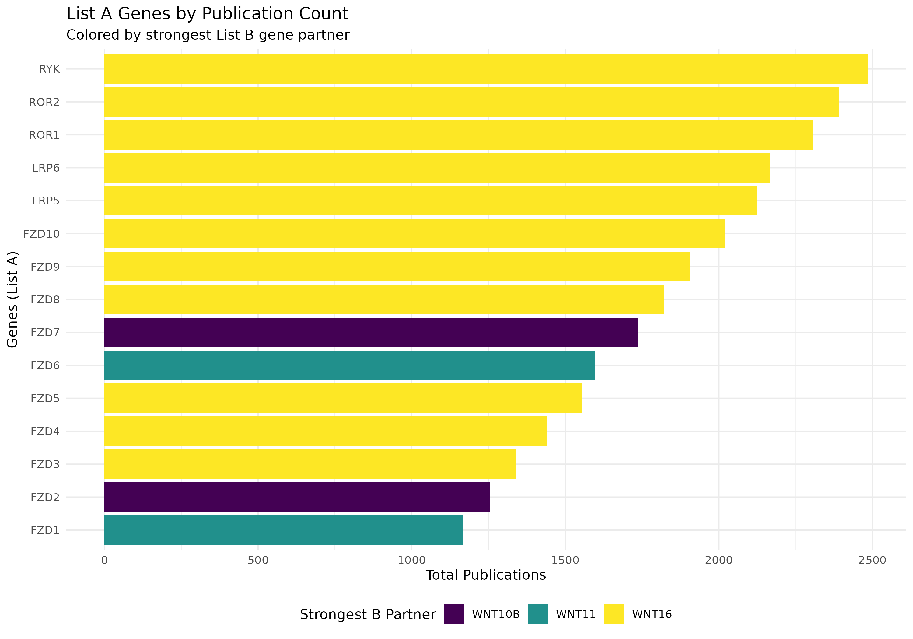
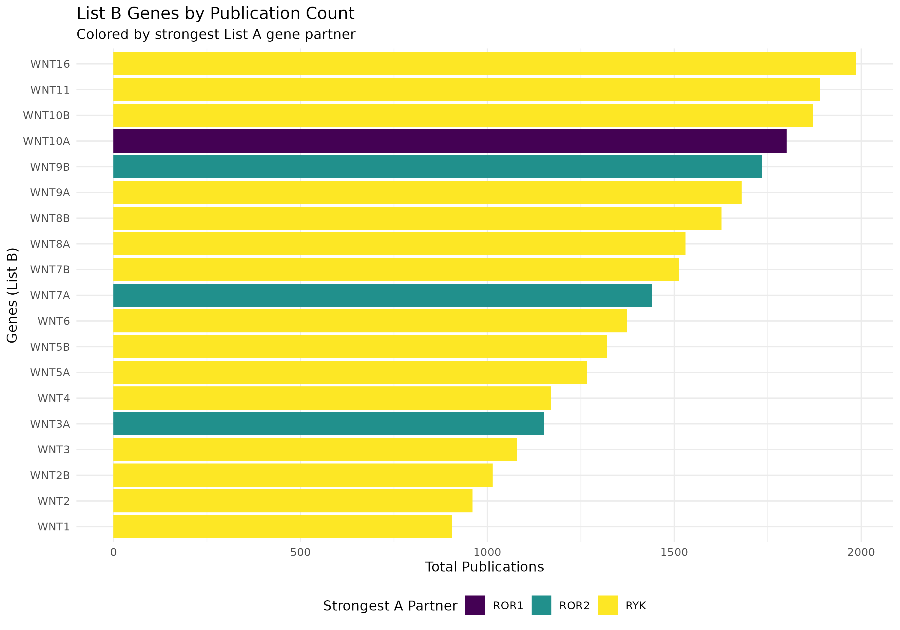
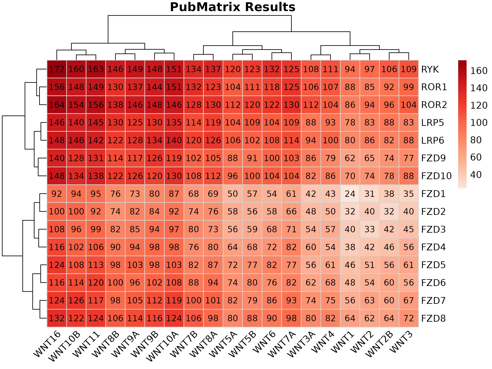

# PubMatrixR with Ligand Receptors


## Introduction

WNT ligands and their receptors do not pair off neatly. A given ligand
can bind several receptors, and the literature reflects that: some
ligand-receptor combinations turn up in paper after paper, others almost
never.

This vignette counts those co-occurrences. It compares 19 WNT ligands
against 15 receptors (FZD1-10, LRP5/6, ROR1/2, RYK), which gives a 15x19
grid of PubMed counts. Bear in mind what the numbers actually measure:
how often two gene symbols appear in the same record, not whether the
paper found them to interact.

``` r

library(PubMatrixR)
library(knitr)
library(kableExtra)
library(dplyr)
library(pheatmap)
library(ggplot2)
```

``` r

A <- c(
  "WNT1", "WNT2", "WNT2B", "WNT3", "WNT3A", "WNT4", "WNT5A", "WNT5B",
  "WNT6", "WNT7A", "WNT7B", "WNT8A", "WNT8B", "WNT9A", "WNT9B",
  "WNT10A", "WNT10B", "WNT11", "WNT16"
)

B <- c(
  "FZD1", "FZD2", "FZD3", "FZD4", "FZD5", "FZD6", "FZD7",
  "FZD8", "FZD9", "FZD10", "LRP5", "LRP6", "ROR1", "ROR2", "RYK"
)
```

## Running the search

A grid this size is 285 separate PubMed searches. With an API key that
takes about half a minute; without one, closer to two. The vignette
skips the live call by default and fills in a synthetic matrix, so the
page builds whether or not NCBI is reachable. Every number below is
fake. Swap in your own gene lists and run the live version to get real
ones.

### NCBI API Key (Recommended)

For better performance and higher rate limits, we recommend obtaining an
NCBI API key:

- **Without API key**: 3 requests per second
- **With API key**: 10 requests per second

To obtain your free NCBI API key, visit:
<https://support.nlm.nih.gov/kbArticle/?pn=KA-05317>

Once you have your API key, pass it to
[`PubMatrix()`](https://toledoem.github.io/PubMatrixR-v2/reference/PubMatrix.md)
like this:

``` r

result <- PubMatrix(
  A = A,
  B = B,
  API.key = "your_api_key_here",
  Database = "pubmed"
)
```

For live rendering, this vignette picks up the key from the
`NCBI_API_KEY` environment variable instead of hardcoding it, so no key
is stored in the file:

``` bash
NCBI_API_KEY=your_api_key_here PUBMATRIX_LIVE_VIGNETTE=true \
  Rscript -e 'pkgdown::build_site()'
```

``` r

current_year <- as.integer(format(Sys.Date(), "%Y"))
result <- PubMatrix(
  A = A,
  B = B,
  API.key = ncbi_api_key,
  Database = "pubmed",
  daterange = c(1990, current_year),
  outfile = "pubmatrix_result"
)
```

``` r

# Offline deterministic example used for vignette rendering/package checks.
result <- outer(seq_along(B), seq_along(A), function(i, j) {
  10 + (i * 5) + (j * 4) + ((i + j) %% 5) * 2 + ((i * j) %% 6)
})
result <- as.data.frame(result, check.names = FALSE)
colnames(result) <- A
rownames(result) <- B
```

## Which genes get the most attention

Before looking at pairs, check the totals. These bar charts sum each
gene’s row or column and colour it by its strongest partner on the other
list, so you can see which receptor dominates a given ligand’s
literature and the other way round.

``` r

# Create data frame for List A genes (rows) colored by List B genes (columns)
a_genes_data <- data.frame(
  gene = rownames(result),
  total_pubs = rowSums(result),
  stringsAsFactors = FALSE
)

# Add color coding based on max overlap with B genes
a_genes_data$max_b_gene <- apply(result, 1, function(x) colnames(result)[which.max(x)])
a_genes_data$max_overlap <- apply(result, 1, max)

# Create data frame for List B genes (columns) colored by List A genes (rows)
b_genes_data <- data.frame(
  gene = colnames(result),
  total_pubs = colSums(result),
  stringsAsFactors = FALSE
)

# Add color coding based on max overlap with A genes
b_genes_data$max_a_gene <- apply(result, 2, function(x) rownames(result)[which.max(x)])
b_genes_data$max_overlap <- apply(result, 2, max)

# Plot A genes colored by their strongest B gene partner
p1 <- ggplot(a_genes_data, aes(x = reorder(gene, total_pubs), y = total_pubs, fill = max_b_gene)) +
  geom_bar(stat = "identity") +
  coord_flip() +
  labs(
    title = "List A Genes by Publication Count",
    subtitle = "Colored by strongest List B gene partner",
    x = "Genes (List A)",
    y = "Total Publications",
    fill = "Strongest B Partner"
  ) +
  theme_minimal() +
  theme(legend.position = "bottom") +
  scale_fill_viridis_d()


# Plot B genes colored by their strongest A gene partner
p2 <- ggplot(b_genes_data, aes(x = reorder(gene, total_pubs), y = total_pubs, fill = max_a_gene)) +
  geom_bar(stat = "identity") +
  coord_flip() +
  labs(
    title = "List B Genes by Publication Count",
    subtitle = "Colored by strongest List A gene partner",
    x = "Genes (List B)",
    y = "Total Publications",
    fill = "Strongest A Partner"
  ) +
  theme_minimal() +
  theme(legend.position = "bottom") +
  scale_fill_viridis_d()


print(p1)
```



``` r

print(p2)
```



## The full matrix

Raw PubMed publication counts for every ligand-receptor pair. Rows are
FZD/LRP/ROR/RYK receptors, columns are WNT ligands.

``` r

kable(result,
  caption = "Co-occurrence Matrix: WNT Genes (Publication Counts)",
  align = "c",
  format = if (knitr::pandoc_to() == "html") "html" else "markdown"
) %>%
  kableExtra::kable_styling(
    bootstrap_options = c("striped", "hover", "condensed"),
    full_width = FALSE,
    position = "center"
  ) %>%
  kableExtra::add_header_above(c(" " = 1, "Wnt Genes" = length(A)))
```

[TABLE]

Co-occurrence Matrix: WNT Genes (Publication Counts) {.table .table
.table-striped .table-hover .table-condensed
style="width: auto !important; margin-left: auto; margin-right: auto;"}

## Heatmaps

Nobody reads a 15x19 table of numbers. The heatmap shows the same data
as colour, and `show_numbers = TRUE` keeps the counts in the cells if
you still want them.

``` r

plot_pubmatrix_heatmap(
  matrix = result,
  title = "WNT - Ligands v/s Receptors",
  show_numbers = TRUE
)
```


Dropping the numbers makes the pattern easier to see when you care about
the shape rather than the exact counts.

``` r

pubmatrix_heatmap(matrix = result)
```



## System Information

``` r

sessionInfo()
```

    ## R version 4.6.2 (2026-10-29)
    ## Platform: x86_64-pc-linux-gnu
    ## Running under: Ubuntu 24.04.5 LTS
    ## 
    ## Matrix products: default
    ## BLAS:   /usr/lib/x86_64-linux-gnu/openblas-pthread/libblas.so.3 
    ## LAPACK: /usr/lib/x86_64-linux-gnu/openblas-pthread/libopenblasp-r0.3.26.so;  LAPACK version 3.12.0
    ## 
    ## locale:
    ##  [1] LC_CTYPE=C.UTF-8       LC_NUMERIC=C           LC_TIME=C.UTF-8       
    ##  [4] LC_COLLATE=C.UTF-8     LC_MONETARY=C.UTF-8    LC_MESSAGES=C.UTF-8   
    ##  [7] LC_PAPER=C.UTF-8       LC_NAME=C              LC_ADDRESS=C          
    ## [10] LC_TELEPHONE=C         LC_MEASUREMENT=C.UTF-8 LC_IDENTIFICATION=C   
    ## 
    ## time zone: UTC
    ## tzcode source: system (glibc)
    ## 
    ## attached base packages:
    ## [1] stats     graphics  grDevices utils     datasets  methods   base     
    ## 
    ## other attached packages:
    ## [1] ggplot2_4.0.3    pheatmap_1.0.13  dplyr_1.2.1      kableExtra_1.4.1
    ## [5] knitr_1.52       PubMatrixR_1.0.1
    ## 
    ## loaded via a namespace (and not attached):
    ##  [1] sass_0.4.10        generics_0.1.4     xml2_1.6.0         stringi_1.8.9     
    ##  [5] digest_0.6.39      magrittr_2.0.5     evaluate_1.0.5     grid_4.6.2        
    ##  [9] RColorBrewer_1.1-3 fastmap_1.2.0      jsonlite_2.0.0     viridisLite_0.4.3 
    ## [13] scales_1.4.0       pbapply_1.7-5      textshaping_1.0.5  jquerylib_0.1.4   
    ## [17] cli_3.6.6          rlang_1.3.0        withr_3.0.3        cachem_1.1.0      
    ## [21] yaml_2.3.12        otel_0.3.0         tools_4.6.2        parallel_4.6.2    
    ## [25] readODS_2.3.6      vctrs_0.7.3        R6_2.6.1           lifecycle_1.0.5   
    ## [29] stringr_1.6.0      fs_2.1.0           ragg_1.5.2         pkgconfig_2.0.3   
    ## [33] desc_1.4.3         pkgdown_2.2.1      bslib_0.12.0       pillar_1.11.1     
    ## [37] gtable_0.3.6       glue_1.8.1         systemfonts_1.3.2  xfun_0.62         
    ## [41] tibble_3.3.1       tidyselect_1.2.1   rstudioapi_0.19.0  farver_2.1.2      
    ## [45] htmltools_0.5.9    rmarkdown_2.32     svglite_2.2.2      labeling_0.4.3    
    ## [49] compiler_4.6.2     S7_0.2.2
