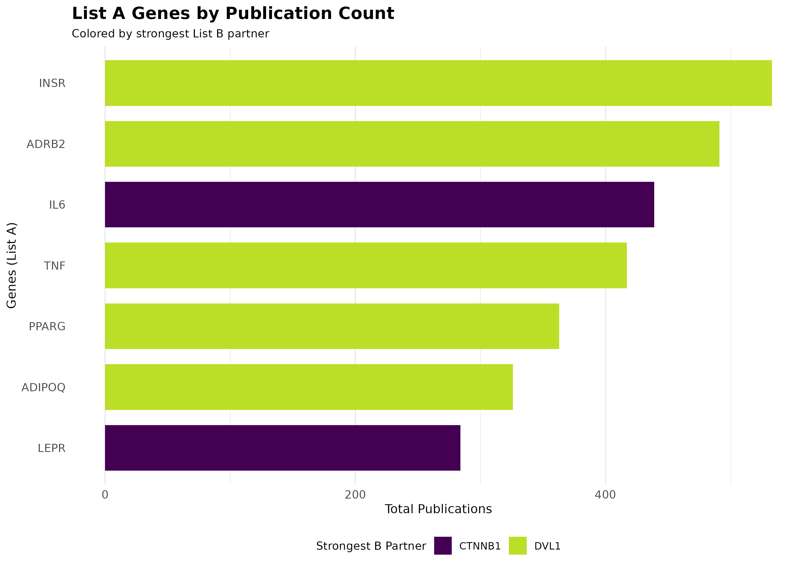
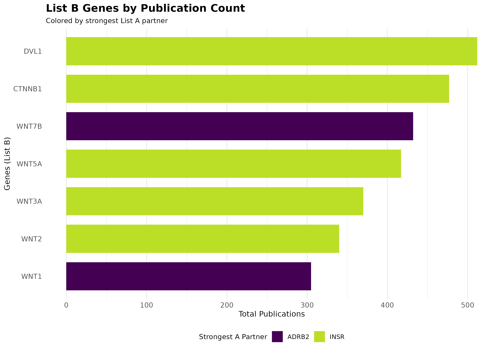
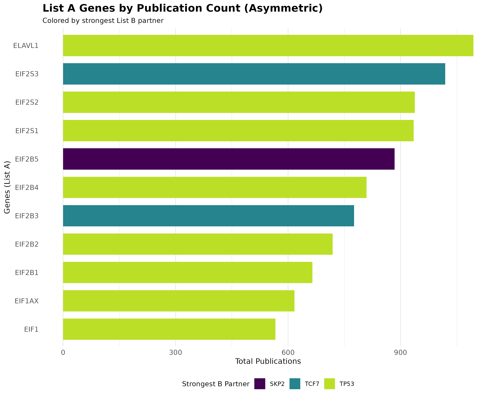
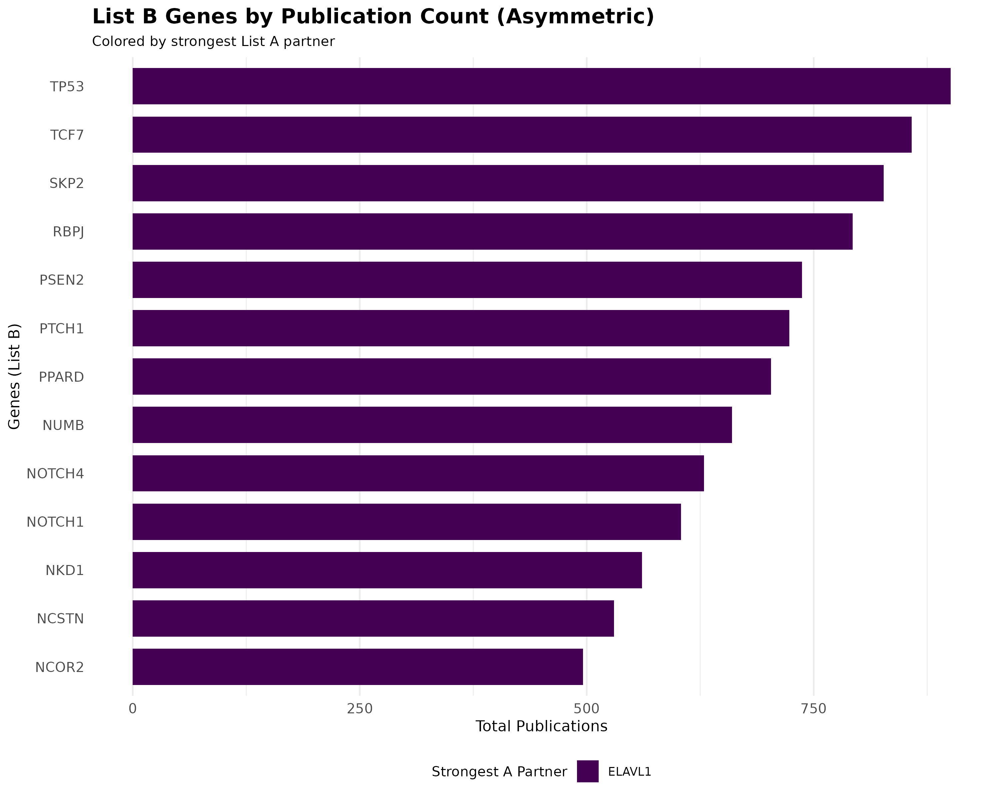

# PubMatrixR: Literature Co-occurrence Analysis

``` r

library(PubMatrixR)
library(knitr)
library(kableExtra)
library(dplyr)
library(pheatmap)
library(ggplot2)
```

## Introduction

PubMatrixR is an R package designed to analyze literature co-occurrence
patterns by systematically searching PubMed and PMC databases. This
vignette demonstrates how to:

- Create co-occurrence matrices from literature searches
- Visualize results using custom heatmaps with overlap percentage
  clustering
- Work with gene sets from MSigDB
- Create bar plots showing publication patterns by gene
- Export results for further analysis

### Acknowledgments

This package is a heavy fork of the original
[PubMatrixR](https://github.com/tslaird/PubMatrixR) by tslaird. Our
gratitude to the original author.

### NCBI API Key (Recommended)

For better performance and higher rate limits, we recommend obtaining an
NCBI API key:

- **Without API key**: 3 requests per second
- **With API key**: 10 requests per second

To obtain your free NCBI API key, visit:
<https://support.nlm.nih.gov/kbArticle/?pn=KA-05317>

Once you have your API key, you can use it in PubMatrixR like this:

``` r

result <- PubMatrix(
  A = gene_set_1,
  B = gene_set_2,
  API.key = "your_api_key_here",
  Database = "pubmed"
)
```

## Preparing Gene Sets

### Making the gene lists from MSigDB

For this example, we’ll extract genes related to WNT signaling and
obesity from the MSigDB database:

`msigdf` is optional and not required to build this vignette. The
example below is shown for reference only and is not executed during
package checks.

``` r

# Extract WNT-related genes
A <- msigdf::msigdf.human %>%
  dplyr::filter(grepl(geneset, pattern = "wnt", ignore.case = TRUE)) %>%
  dplyr::pull(symbol) %>%
  unique()

# Extract obesity-related genes
B <- msigdf::msigdf.human %>%
  dplyr::filter(grepl(geneset, pattern = "obesity", ignore.case = TRUE)) %>%
  dplyr::pull(symbol) %>%
  unique()

# Sample genes for demonstration (making them equal in length)
A <- sample(A, 10, replace = FALSE)
B <- sample(B, 10, replace = FALSE)
```

### Fallback Example Dataset

When MSigDB is not available, we use these representative gene sets:

``` r

# WNT signaling pathway genes
A <- c("WNT1", "WNT2", "WNT3A", "WNT5A", "WNT7B", "CTNNB1", "DVL1")

# Obesity-related genes
B <- c("LEPR", "ADIPOQ", "PPARG", "TNF", "IL6", "ADRB2", "INSR")
```

## Literature Analysis

### Running PubMatrixR

Now we’ll search for co-occurrences between our gene sets in PubMed
literature:

``` r

# Run actual PubMatrix analysis
current_year <- as.integer(format(Sys.Date(), "%Y"))
result <- PubMatrix(
  A = A,
  B = B,
  Database = "pubmed",
  daterange = c(2020, current_year),
  outfile = "pubmatrix_result"
)
```

``` r

# Offline deterministic example used for vignette rendering/package checks.
result <- outer(seq_along(B), seq_along(A), function(i, j) {
  8 + (i * 6) + (j * 5) + ((i + j) %% 4) * 3 + ((i * j) %% 5)
})
result <- as.data.frame(result, check.names = FALSE)
colnames(result) <- A
rownames(result) <- B
```

### Results Table

The co-occurrence matrix shows the number of publications mentioning
each pair of genes:

``` r

kable(result,
  caption = "Co-occurrence Matrix: WNT Genes vs Obesity Genes (Publication Counts)",
  align = "c",
  format = if (knitr::pandoc_to() == "html") "html" else "markdown"
) %>%
  kableExtra::kable_styling(
    bootstrap_options = c("striped", "hover", "condensed"),
    full_width = FALSE,
    position = "center"
  ) %>%
  kableExtra::add_header_above(c(" " = 1, "Obesity Genes" = length(B)))
```

[TABLE]

Co-occurrence Matrix: WNT Genes vs Obesity Genes (Publication Counts)
{.table .table .table-striped .table-hover .table-condensed
style="width: auto !important; margin-left: auto; margin-right: auto;"}

## Visualization

### Publication Count Bar Plots

Let’s first examine which genes have the highest publication counts:

``` r

# Create data frame for List A genes (rows) colored by List B genes (columns)
a_genes_data <- data.frame(
  gene = rownames(result),
  total_pubs = rowSums(result),
  stringsAsFactors = FALSE
)

# Add color coding based on max overlap with B genes
a_genes_data$max_b_gene <- apply(result, 1, function(x) colnames(result)[which.max(x)])
a_genes_data$max_overlap <- apply(result, 1, max)

# Create data frame for List B genes (columns) colored by List A genes (rows)
b_genes_data <- data.frame(
  gene = colnames(result),
  total_pubs = colSums(result),
  stringsAsFactors = FALSE
)

# Add color coding based on max overlap with A genes
b_genes_data$max_a_gene <- apply(result, 2, function(x) rownames(result)[which.max(x)])
b_genes_data$max_overlap <- apply(result, 2, max)

bar_plot_theme <- theme_minimal(base_size = 12) +
  theme(
    plot.title = element_text(face = "bold", size = 15),
    plot.subtitle = element_text(size = 10),
    axis.title = element_text(size = 11),
    axis.text = element_text(size = 10),
    panel.grid.major.y = element_blank(),
    legend.position = "bottom",
    legend.title = element_text(size = 10),
    legend.text = element_text(size = 9),
    legend.box = "vertical"
  )

n_fill_a <- length(unique(a_genes_data$max_b_gene))
n_fill_b <- length(unique(b_genes_data$max_a_gene))

# Plot A genes colored by their strongest B gene partner
p1 <- ggplot(a_genes_data, aes(x = reorder(gene, total_pubs), y = total_pubs, fill = max_b_gene)) +
  geom_col(width = 0.75) +
  coord_flip() +
  labs(
    title = "List A Genes by Publication Count",
    subtitle = "Colored by strongest List B partner",
    x = "Genes (List A)",
    y = "Total Publications",
    fill = "Strongest B Partner"
  ) +
  scale_fill_viridis_d(option = "D", end = 0.9) +
  guides(fill = guide_legend(nrow = max(1, ceiling(n_fill_a / 4)), byrow = TRUE)) +
  bar_plot_theme


# Plot B genes colored by their strongest A gene partner
p2 <- ggplot(b_genes_data, aes(x = reorder(gene, total_pubs), y = total_pubs, fill = max_a_gene)) +
  geom_col(width = 0.75) +
  coord_flip() +
  labs(
    title = "List B Genes by Publication Count",
    subtitle = "Colored by strongest List A partner",
    x = "Genes (List B)",
    y = "Total Publications",
    fill = "Strongest A Partner"
  ) +
  scale_fill_viridis_d(option = "D", end = 0.9) +
  guides(fill = guide_legend(nrow = max(1, ceiling(n_fill_b / 4)), byrow = TRUE)) +
  bar_plot_theme


print(p1)
```



``` r

print(p2)
```



### Heatmap with Overlap Percentages

The heatmap displays overlap percentages calculated from the publication
co-occurrence counts:

``` r

plot_pubmatrix_heatmap(result,
  title = "WNT-Obesity Overlap (%)",
  show_numbers = TRUE,
  cellwidth = 44,
  cellheight = 32,
  width = 12,
  height = 10
)
```


Overlap percentage heatmap with values displayed in each cell

### Clean Heatmap

For a cleaner visualization without numbers, useful for presentations:

``` r

plot_pubmatrix_heatmap(result,
  title = "WNT-Obesity Co-occurrence (Clean)",
  show_numbers = FALSE,
  cellwidth = 44,
  cellheight = 32,
  width = 12,
  height = 10
)
```


Co-occurrence heatmap without numbers for better visual clarity

Asymmetric lists

``` r

A <- c("NCOR2", "NCSTN", "NKD1", "NOTCH1", "NOTCH4", "NUMB", "PPARD", "PSEN2", "PTCH1", "RBPJ", "SKP2", "TCF7", "TP53")


B <- c("EIF1", "EIF1AX", "EIF2B1", "EIF2B2", "EIF2B3", "EIF2B4", "EIF2B5", "EIF2S1", "EIF2S2", "EIF2S3", "ELAVL1")


# Run actual PubMatrix analysis
current_year <- as.integer(format(Sys.Date(), "%Y"))
result <- PubMatrix(
  A = A,
  B = B,
  Database = "pubmed",
  daterange = c(2020, current_year),
  outfile = "pubmatrix_result"
)
```

``` r

# Offline deterministic example used for vignette rendering/package checks.
A <- c("NCOR2", "NCSTN", "NKD1", "NOTCH1", "NOTCH4", "NUMB", "PPARD", "PSEN2", "PTCH1", "RBPJ", "SKP2", "TCF7", "TP53")
B <- c("EIF1", "EIF1AX", "EIF2B1", "EIF2B2", "EIF2B3", "EIF2B4", "EIF2B5", "EIF2S1", "EIF2S2", "EIF2S3", "ELAVL1")

result <- outer(seq_along(B), seq_along(A), function(i, j) {
  12 + (i * 4) + (j * 3) + ((i * j) %% 9) + ((i + 2 * j) %% 6)
})
result <- as.data.frame(result, check.names = FALSE)
colnames(result) <- A
rownames(result) <- B
```

### Results Table

The co-occurrence matrix shows the number of publications mentioning
each pair of genes:

``` r

kable(result,
  caption = "Co-occurrence Matrix: Longer Lists (Publication Counts)",
  align = "c",
  format = if (knitr::pandoc_to() == "html") "html" else "markdown"
) %>%
  kableExtra::kable_styling(
    bootstrap_options = c("striped", "hover", "condensed"),
    full_width = FALSE,
    position = "center"
  ) %>%
  kableExtra::add_header_above(c(" " = 1, "A Genes" = length(A)))
```

[TABLE]

Co-occurrence Matrix: Longer Lists (Publication Counts) {.table .table
.table-striped .table-hover .table-condensed
style="width: auto !important; margin-left: auto; margin-right: auto;"}

### Bar Plots for Asymmetric Lists

``` r

# Create data frame for List A genes (rows) colored by List B genes (columns)
a_genes_data2 <- data.frame(
  gene = rownames(result),
  total_pubs = rowSums(result),
  stringsAsFactors = FALSE
)

# Add color coding based on max overlap with B genes
a_genes_data2$max_b_gene <- apply(result, 1, function(x) colnames(result)[which.max(x)])
a_genes_data2$max_overlap <- apply(result, 1, max)

# Create data frame for List B genes (columns) colored by List A genes (rows)
b_genes_data2 <- data.frame(
  gene = colnames(result),
  total_pubs = colSums(result),
  stringsAsFactors = FALSE
)

# Add color coding based on max overlap with A genes
b_genes_data2$max_a_gene <- apply(result, 2, function(x) rownames(result)[which.max(x)])
b_genes_data2$max_overlap <- apply(result, 2, max)

bar_plot_theme <- theme_minimal(base_size = 12) +
  theme(
    plot.title = element_text(face = "bold", size = 15),
    plot.subtitle = element_text(size = 10),
    axis.title = element_text(size = 11),
    axis.text = element_text(size = 10),
    panel.grid.major.y = element_blank(),
    legend.position = "bottom",
    legend.title = element_text(size = 10),
    legend.text = element_text(size = 8.5),
    legend.box = "vertical"
  )

n_fill_a2 <- length(unique(a_genes_data2$max_b_gene))
n_fill_b2 <- length(unique(b_genes_data2$max_a_gene))

# Plot A genes colored by their strongest B gene partner
p3 <- ggplot(a_genes_data2, aes(x = reorder(gene, total_pubs), y = total_pubs, fill = max_b_gene)) +
  geom_col(width = 0.75) +
  coord_flip() +
  labs(
    title = "List A Genes by Publication Count (Asymmetric)",
    subtitle = "Colored by strongest List B partner",
    x = "Genes (List A)",
    y = "Total Publications",
    fill = "Strongest B Partner"
  ) +
  scale_fill_viridis_d(option = "D", end = 0.9) +
  guides(fill = guide_legend(nrow = max(1, ceiling(n_fill_a2 / 4)), byrow = TRUE)) +
  bar_plot_theme


# Plot B genes colored by their strongest A gene partner
p4 <- ggplot(b_genes_data2, aes(x = reorder(gene, total_pubs), y = total_pubs, fill = max_a_gene)) +
  geom_col(width = 0.75) +
  coord_flip() +
  labs(
    title = "List B Genes by Publication Count (Asymmetric)",
    subtitle = "Colored by strongest List A partner",
    x = "Genes (List B)",
    y = "Total Publications",
    fill = "Strongest A Partner"
  ) +
  scale_fill_viridis_d(option = "D", end = 0.9) +
  guides(fill = guide_legend(nrow = max(1, ceiling(n_fill_b2 / 4)), byrow = TRUE)) +
  bar_plot_theme


print(p3)
```



``` r

print(p4)
```



### Heatmap with Overlap Percentages

The heatmap displays overlap percentages calculated from the publication
co-occurrence counts:

``` r

plot_pubmatrix_heatmap(result,
  title = "Asymmetric Lists Overlap (%)",
  show_numbers = TRUE,
  cellwidth = 44,
  cellheight = 32,
  width = 12,
  height = 10
)
```


Overlap percentage heatmap with values displayed in each cell

### Clean Heatmap

For a cleaner visualization without numbers, useful for presentations:

``` r

plot_pubmatrix_heatmap(result,
  title = "Asymmetric Lists Co-occurrence (Clean)",
  show_numbers = FALSE,
  cellwidth = 44,
  cellheight = 32,
  width = 12,
  height = 10
)
```


Co-occurrence heatmap without numbers for better visual clarity

## Summary

This vignette demonstrated:

1.  **Gene Set Preparation**: Using MSigDB or manual curation to create
    meaningful gene lists
2.  **Literature Analysis**: Running PubMatrixR to generate
    co-occurrence matrices
3.  **Data Visualization**: Creating publication-ready heatmaps with
    custom color schemes and bar plots
4.  **Results Interpretation**: Understanding co-occurrence patterns in
    the literature

The resulting matrices and visualizations can help identify: - Strong
literature connections between gene sets - Potential research gaps (low
co-occurrence pairs) - Patterns in publication trends over time - Most
studied genes and their strongest literature partners

## System Information

``` r

sessionInfo()
#> R version 4.6.2 (2026-10-29)
#> Platform: x86_64-pc-linux-gnu
#> Running under: Ubuntu 24.04.5 LTS
#> 
#> Matrix products: default
#> BLAS:   /usr/lib/x86_64-linux-gnu/openblas-pthread/libblas.so.3 
#> LAPACK: /usr/lib/x86_64-linux-gnu/openblas-pthread/libopenblasp-r0.3.26.so;  LAPACK version 3.12.0
#> 
#> locale:
#>  [1] LC_CTYPE=C.UTF-8       LC_NUMERIC=C           LC_TIME=C.UTF-8       
#>  [4] LC_COLLATE=C.UTF-8     LC_MONETARY=C.UTF-8    LC_MESSAGES=C.UTF-8   
#>  [7] LC_PAPER=C.UTF-8       LC_NAME=C              LC_ADDRESS=C          
#> [10] LC_TELEPHONE=C         LC_MEASUREMENT=C.UTF-8 LC_IDENTIFICATION=C   
#> 
#> time zone: UTC
#> tzcode source: system (glibc)
#> 
#> attached base packages:
#> [1] stats     graphics  grDevices utils     datasets  methods   base     
#> 
#> other attached packages:
#> [1] ggplot2_4.0.3    pheatmap_1.0.13  dplyr_1.2.1      kableExtra_1.4.1
#> [5] knitr_1.52       PubMatrixR_1.0.1
#> 
#> loaded via a namespace (and not attached):
#>  [1] sass_0.4.10        generics_0.1.4     xml2_1.6.0         stringi_1.8.9     
#>  [5] digest_0.6.39      magrittr_2.0.5     evaluate_1.0.5     grid_4.6.2        
#>  [9] RColorBrewer_1.1-3 fastmap_1.2.0      jsonlite_2.0.0     viridisLite_0.4.3 
#> [13] scales_1.4.0       pbapply_1.7-5      textshaping_1.0.5  jquerylib_0.1.4   
#> [17] cli_3.6.6          rlang_1.3.0        withr_3.0.3        cachem_1.1.0      
#> [21] yaml_2.3.12        otel_0.3.0         tools_4.6.2        parallel_4.6.2    
#> [25] readODS_2.3.6      vctrs_0.7.3        R6_2.6.1           lifecycle_1.0.5   
#> [29] stringr_1.6.0      fs_2.1.0           ragg_1.5.2         pkgconfig_2.0.3   
#> [33] desc_1.4.3         pkgdown_2.2.1      bslib_0.12.0       pillar_1.11.1     
#> [37] gtable_0.3.6       glue_1.8.1         systemfonts_1.3.2  xfun_0.62         
#> [41] tibble_3.3.1       tidyselect_1.2.1   rstudioapi_0.19.0  farver_2.1.2      
#> [45] htmltools_0.5.9    rmarkdown_2.32     svglite_2.2.2      labeling_0.4.3    
#> [49] compiler_4.6.2     S7_0.2.2
```
